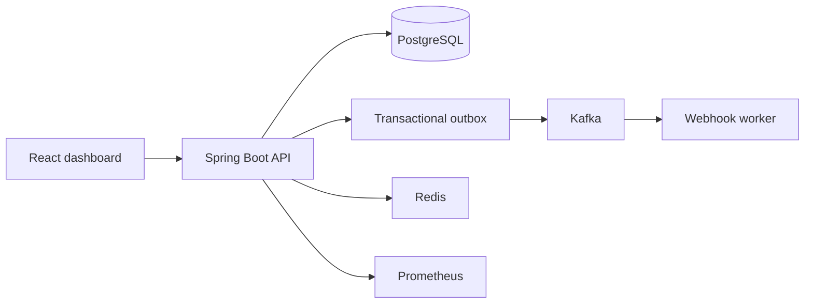

# Architecture

PulsePay uses a React single-page application and a modular Spring Boot API. PostgreSQL is the system of record; all money is represented as integer minor units with a three-letter ISO currency code. Kafka is an asynchronous transport, never the source of truth.

The API owns authorization, merchant scoping, idempotency, state transitions, ledger posting, and audit logging. Future payment state changes will write the domain record and its outbox event in one PostgreSQL transaction. A publisher will then relay the outbox to Kafka, and consumers will deduplicate by event ID.

## Phase plan

1. Foundation — service shells, migrations, Docker, CI, health checks.
2. Authentication — registration, BCrypt, JWT/refresh lifecycle, roles and merchant isolation.
3. Payment intents — validated state machine, idempotency and simulated processing.
4. Authorization, capture, refunds — locking and concurrency tests.
5. Ledger — balanced immutable journals and reversals.
6. Events — outbox publisher, Kafka retries and consumer deduplication.
7. Developer tools — webhooks and API keys.
8. Dashboard — real aggregated APIs and responsive React flows.

