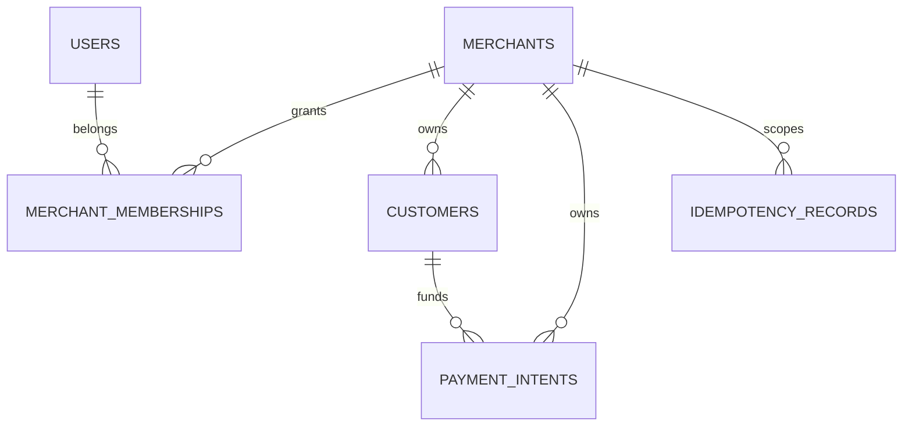

# Database design

The Phase 1 migration establishes tenant and reliability primitives. `merchants` owns `customers`, `payment_intents`, `idempotency_records`, and audit entries. All tenant foreign keys use `ON DELETE RESTRICT`, protecting future financial history. `payment_intents.version` reserves optimistic concurrency control for lifecycle transitions.

`outbox_events` is written in the same transaction as a domain change. A later publisher is responsible for Kafka delivery, preventing a committed payment without a recoverable event.

## Financial integrity guards

Migration V4 adds a deferred PostgreSQL constraint trigger that rejects any transaction committing an unbalanced journal. It is deferred because a journal is inserted as a debit/credit pair in one transaction. Separate immutable triggers reject updates/deletes to posted journals and entries; fixes must be represented by a reversal journal.

